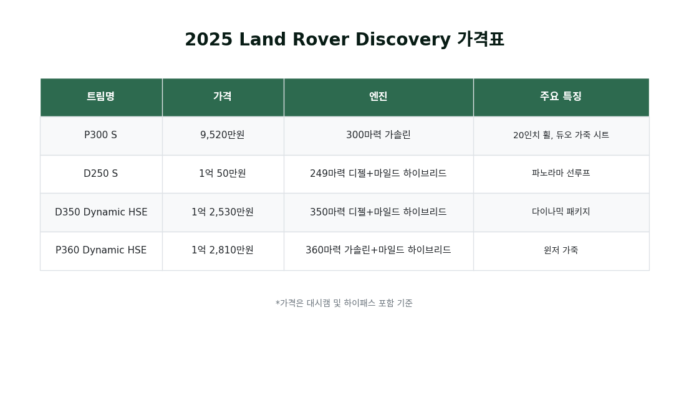
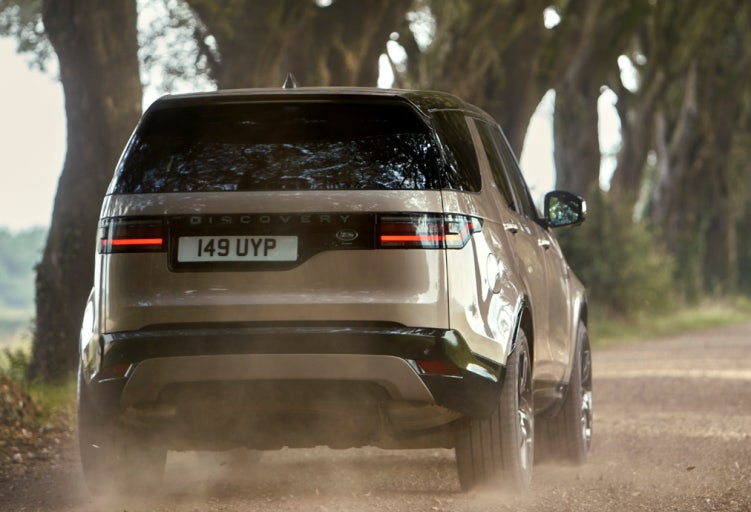

아래는 전면 재작성한 본문입니다.

---

랜드로버 디스커버리 가격은 트림과 엔진 구성에 따라 9천만 원대 후반에서 1억 3천만 원대까지 폭넓게 걸쳐 있다. 정확한 금액은 랜드로버 코리아 공식 홈페이지의 가격 정보 페이지에 연식별로 공개돼 있으니, 구매를 앞두고 있다면 그곳에서 최신 가격표를 직접 확인하는 편이 가장 정확하다.

## 디스커버리 가격대는 왜 이렇게 폭이 넓을까

디스커버리는 엔진 종류만 두 갈래, 트림은 네다섯 단계로 나뉜다. 가장 저렴한 가솔린 S 트림과 최상위 템페스트 에디션 사이의 가격 차이는 수천만 원에 달한다. 그 차이를 만드는 건 엔진 출력보다 오히려 서스펜션, 휠, 가죽 시트 등급, 인포테인먼트 사양 같은 편의 구성인 경우가 많다. 그래서 단순히 "디스커버리 얼마냐"고 묻기보다, 어떤 트림을 기준으로 보는지부터 정해야 가격 비교가 의미를 갖는다.

## 트림별로 엔진과 가격은 어떻게 다를까

랜드로버 코리아가 공개해온 가격표를 보면 디스커버리는 디젤 D300·D350, 가솔린 P300·P360 계열 엔진을 운영해왔고, 연식에 따라 S·Dynamic SE·Dynamic HSE·템페스트 에디션 순으로 트림이 올라간다. 모델명에 붙는 숫자는 대략적인 출력을 나타내는 랜드로버식 표기법이다. 다만 트림 구성과 엔진 라인업은 연식이 바뀔 때마다 조정되는 편이라, 지금 판매 중인 정확한 조합과 가격은 아래 표의 항목을 공식 사이트에서 대조해보길 권한다.

| 구분 | 엔진 특징 | 가격 |
|---|---|---|
| S (기본) | 가솔린 또는 디젤, 에어 서스펜션 기본 탑재 | 공식 사이트 확인 |
| Dynamic SE | 중간 등급, 외관·인포테인먼트 상향 | 공식 사이트 확인 |
| Dynamic HSE | 상위 등급, 가죽 시트·헤드업 디스플레이 | 공식 사이트 확인 |
| 템페스트 에디션 | 최상위, 전용 외장·인테리어 | 공식 사이트 확인 |

## 디스커버리 스포츠와 가격 차이는 얼마나 날까

같은 랜드로버 라인업 안에서 디스커버리 스포츠는 일반 디스커버리보다 한 단계 아래 체급이고, 가격도 그만큼 낮게 책정돼 있다. 두 모델은 차체 크기와 플랫폼 자체가 다르기 때문에 가격만 보고 상위·하위를 가르기보다는, 7인승 활용도와 오프로드 성능이 얼마나 필요한지를 먼저 따져보는 게 맞다. 실제 트림별 금액 비교는 두 모델의 공식 가격표를 나란히 놓고 보는 방법이 가장 확실하다.

## 7인승 좌석, 가격만큼 실용적일까

디스커버리는 7인승을 표방하지만 3열은 성인이 장시간 앉기엔 다소 좁다는 평가가 많다. 아이들이나 짧은 거리 탑승에는 무리가 없지만, 성인 다섯 명 이상이 자주 함께 타야 한다면 1열과 2열 공간의 여유로움에 비해 3열은 보조석 느낌이 강하다. 3열을 접었을 때의 적재공간은 넉넉한 편이라, 평소엔 5인승처럼 쓰고 필요할 때만 7인승으로 전환하는 사용 패턴에 더 어울린다.

## 오프로드 성능은 가격값을 할까

전자식 에어 서스펜션과 지형 반응 시스템, 힐 디센트 컨트롤 같은 기능은 디스커버리 가격에서 적지 않은 비중을 차지한다. 포장도로 위주로만 탄다면 이 기능들은 과한 투자로 보일 수 있다. 반대로 스키장이나 캠핑장처럼 비포장 구간을 자주 오간다면, 같은 가격대의 경쟁 모델에서는 찾기 어려운 실질적인 차별점이 된다.

## 어떤 사람에게 맞을까

오프로드 주행이 잦고 장거리 운전을 자주 하면서 디젤의 경제성을 원한다면 디스커버리는 꽤 합리적인 선택지가 된다. 반면 성인 7명이 상시 탑승해야 하거나, 스포티한 핸들링을 최우선으로 꼽는다면 다른 세그먼트를 함께 비교해보는 게 낫다. 가격 역시 트림에 따라 차이가 크므로, 예산을 먼저 정한 뒤 그 안에서 고를 수 있는 트림을 역으로 좁혀가는 방식이 효율적이다.

## 자주 묻는 질문

**디스커버리 디젤과 가솔린, 유지비는 어느 쪽이 유리할까**
디젤 모델이 연료 효율 면에서 상대적으로 유리하다고 알려져 있지만, 정확한 복합연비와 유류비 차이는 환경부 자동차 연료소비효율 사이트나 공식 제원표에서 트림별로 비교해보는 게 정확하다.

**중고 디스커버리 가격은 신차보다 얼마나 낮을까**
연식과 주행거리, 트림, 사고 여부에 따라 편차가 매우 커서 일괄적으로 말하기는 어렵다. 중고차 가격 비교 플랫폼에서 실제 매물 시세를 확인하는 방법이 가장 현실적이다.

**가격표에 없는 할인이나 프로모션도 있을까**
수입차는 시기별로 전시장 할인이나 금융 프로모션이 붙는 경우가 흔하다. 다만 조건이 매장과 시점마다 달라서, 구매 직전에는 전시장이나 공식 홈페이지의 최신 공지를 확인해보는 게 안전하다.
