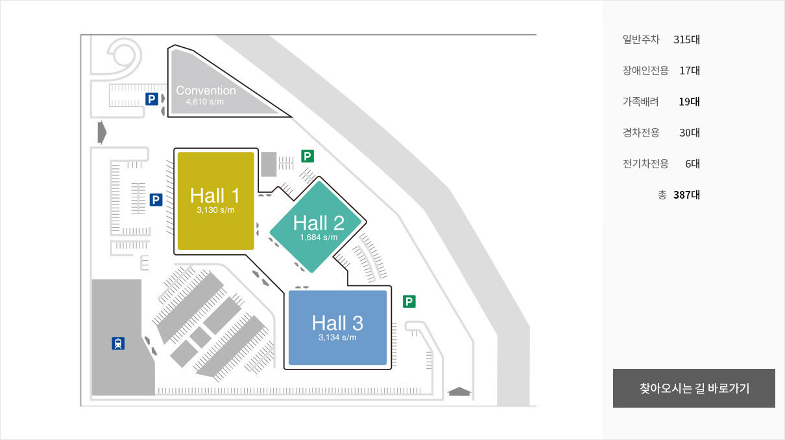
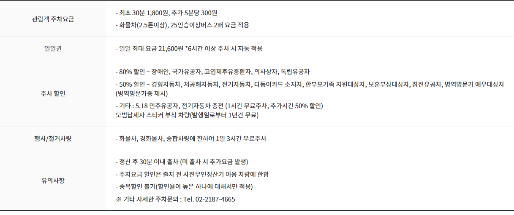
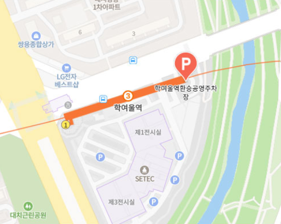
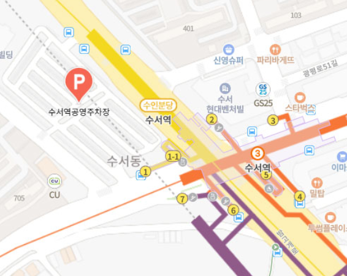
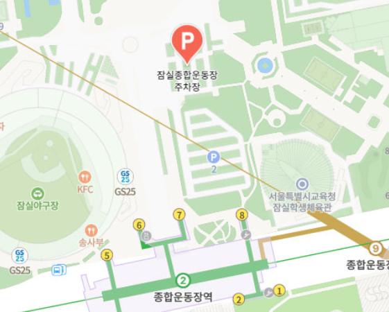
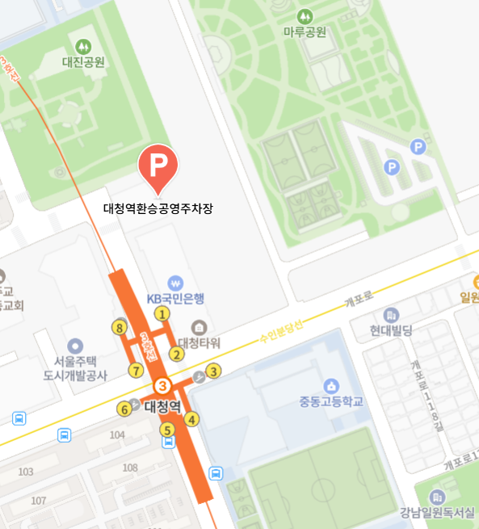

## 학여울역 SETEC 주차 총정리

SETEC(서울무역전시컨벤션센터)은 전시회·박람회가 자주 열리는 강남 대표 전시장입니다. 하지만 학여울역 인근 주차장은 행사 때마다 금세 만차가 되는 경우가 많죠.

이번 글에서는 SETEC 전용 주차장, 학여울역 공영주차장, 은마상가 주차장, 대체 주차장, 그리고 대중교통 이용 꿀팁까지 모두 정리했습니다.

### 1. SETEC 전용 주차장 안내

### 위치: 서울 강남구 남부순환로 3104

주차 문의: SETEC 주차 담당 02-2187-4665

🗺 [네이버 지도에서 SETEC 보기](https://map.naver.com/p/search/SETEC) — 길찾기·주변 주차장을 지도에서 바로 확인할 수 있습니다.

주차 가능: 총 420대 (일반 369 / 장애인 17 / 여성전용 20 / 경차 10 / 전기차 4)

### 요금 체계

• 입차 후 20분 이내 출차: 무료

• 최초 30분: 1,800원

• 추가: 5분당 300원 (1시간 3,600원)

• 일일 최대: 21,600원 (6시간 이상 주차 시 자동 적용)

• 화물차·대형버스: 2배 요금 (SETEC 공식 안내에서 확인하지 못한 항목 — 방문 전 02-2187-4665로 확인하세요)

### 할인 혜택

• 80%: 장애인, 국가유공자, 독립유공자

• 50%: 경차, 전기차, 다둥이카드 소지자

• 전기차 충전 시: 1시간 무료 + 추가 50% 할인

• 모범납세자 차량: 1년간 무료

### ⚠ 주의사항

• 행사 기간에는 오전 9시 이전 도착 필수(9시 넘어가면 주차 진입로 줄이 엄청납니다)

• 정산 후 30분 이내 출차해야 추가 요금 없음

### 2. 학여울역 환승공영주차장 ⭐ (추천)

### 위치: 강남구 대치동 514-1 (SETEC 도보 3분 거리)

주차 가능: 180면 · 주차 문의 02-3405-4074

⏰ 운영시간: 05:00 ~ 익일 01:00 (연중무휴)

⚠️ 진입 높이제한 2.1m — 높은 차량은 진입할 수 없습니다.

학여울역 환승공영주차장

### 요금 체계

• 5분당 370원 (1시간 4,440원)

• 정기주차: 월 168,000원

• 환승 할인 시 50% (대중교통 이용 후 30분 내 정산기에 교통카드 터치) — 다만 서울시설공단 감면 안내에 '녹색교통지역 제외' 조건이 붙어 있어, 이 주차장이 해당되는지는 확인하지 못했습니다. 환승 할인을 계획한다면 02-3405-4074로 먼저 확인하세요.

• 미세먼지 시즌제(12~3월) 기간에는 5등급 차량에 할증이 적용됩니다: 5분당 555원, 정기주차 252,000원

### 할인 혜택

• 80%: 장애인, 국가유공자

• 50%: 경차, 전기차, 다둥이카드, 환승 이용객

• 20%: 참전유공자, 병역명문가

**➡ 만차를 피하고 싶다면 여기가 1순위입니다.** SETEC 도보 3분이라 접근성은 사실상 같은데, 행사 날 전용 주차장 진입 줄에 갇히지 않는 것이 가장 큰 장점입니다. 운영시간도 익일 01시까지 길고, 대중교통으로 움직일 계획이면 환승 할인까지 노려볼 수 있습니다.

단, **요금만 보면 SETEC 전용 주차장보다 비쌉니다**(5분당 370원 vs 300원). 짧게 머물며 요금만 아끼려는 목적이라면 여기가 정답이 아니고, '만차 회피·긴 운영시간·환승'이 필요할 때 쓰는 선택지입니다.

### 3. 은마아파트 상가 주차장 & 휴무일 팁

### 위치: 강남구 대치동 316 (은마종합상가)

수용: 약 380~400대

### 요금 체계

• 카드 전용, 무인정산기 결제

🔴 **요금·무료주차 조건은 확인하지 못했습니다.** 민영 상가 주차장이라 공식 안내를 찾지 못했고, '90분 무료'로 알려져 있으나 무료 적용에 구매 영수증이 필요한지에 대해 자료마다 설명이 엇갈립니다. 무료주차를 기대하고 가지 마시고, 방문 전 상가 관리사무소나 현장 안내판에서 직접 확인하세요.

### 상가 휴무일(2,4주차 일요일)

• 주차 가능 ✅

• 이용객이 적어 여유로운 편

**➡ 행사 날 만차일 경우 “비상 주차장”으로 활용 가능.** 다만 무료주차 조건과 휴무일 운영 방식은 위에 적은 대로 공식 확인이 되지 않았으니, 요금을 계산에 넣고 가야 합니다.

### 4. 인근 대체 주차장

### 수서역 공영주차장 (약 1.5km)

• 요금: 5분당 300원

• 비교적 여유, 버스 환승 편리 (거리는 버스로 15분)

수서역 공영주차장

### 잠실종합운동장 주차장 (약 3km)

• 대규모 수용

• 전시 기간엔 셔틀버스 운영 가능

잠실종합운동장 주차

### 대청역 환승공영주차장

• 3호선 환승 용이

• 정기주차권 저렴하나 자리가 많지 않아요

대청역 환승공영주차장

### 5. 주말·축제•전시 기간 주차 꿀팁

• 혼잡 시간: 오전 11시~오후 3시

• ⏰ 도착 전략: 개장 1시간 전 or 폐장 1시간 전

• 앱 활용: 카카오T, 모두의주차장 등으로 미리 확인

• 할인 준비: 교통카드·증빙서류 챙기기

• 출차 전략: 행사 종료 직전은 피해야 정체 없음

### 6. 대중교통 이용법 (가장 추천!)

• 지하철: 3호선 학여울역 1번 출구 바로 연결

• 버스: 401, 408, 440, 470 / 3412, 4319 / 광역 9407 등

• 분당선: 수서역 → 버스 환승 or 도보 15분

**➡ 행사 성수기에는 대중교통이 가장 확실한 방법입니다.**

### 주차 요금 비교 (종합)

### SETEC 전용 주차장

· 30분: 1,800원

· 1시간: 3,600원

· 4시간: 14,400원

· 특징: 전시장 내부 위치, 입차 후 20분 이내 출차 시 무료

### 학여울역 환승공영주차장

· 30분: 2,220원

· 1시간: 4,440원

· 4시간: 17,760원

· 특징: 도보 3분 거리, 180면, 익일 01시까지 운영, 환승 할인 가능(조건 확인 필요)

### 은마아파트 상가 주차장

· 요금·무료주차 조건 미확인 — 공식 안내를 찾지 못했습니다(위 3번 항목 참고)

· 특징: 만차 시 비상 대안. 요금을 계산에 넣고 방문하세요

※ 위 요금은 각 주차장 공식 요율(SETEC 최초 30분 1,800원·추가 5분당 300원 / 학여울역 5분당 370원)로 계산한 값입니다. 할인·감면을 적용하지 않은 기준이며, 실제 정산액은 현장 안내가 우선입니다.

학여울역과 SETEC은 전시·박람회 방문객이 많아 주차 혼잡은 감수하셔야 해요. 꼭 본인 상황에 맞는 전략을 세워서, 주차 스트레스 없이 즐거운 전시회 관람하시길 바랍니다. ?✨

**비용 절약: SETEC 전용**(5분당 300원으로 학여울역보다 저렴) — 단 행사 날은 진입 줄을 감수해야 합니다

**만차 회피·긴 운영시간: 학여울역 환승공영주차장**(도보 3분, 익일 01시까지)

**여유로운 선택: 대중교통**

※ 학여울역 환승할인(50%)이 적용되면 요금 순서가 뒤바뀔 수 있지만, 적용 조건을 확인하지 못했습니다(위 2번 항목 참고).

※ 본 글의 SETEC 주차요금·할인·문의처는 SETEC 공식 안내, 학여울역 환승공영주차장 정보는 서울시설공단 공식 안내(2026년 8월 11일 확인 기준)를 토대로 작성했습니다. SETEC 주차 면수와 주차장 운영시간, 화물차·대형버스 요금, 은마상가 주차 조건은 공식 안내에서 확인하지 못해 단정하지 않았습니다. 요금은 변경될 수 있으니 방문 전 공식 공지를 확인하세요.

[출처]

- SETEC 전시장 주차안내: [https://www.setec.or.kr/front/traffic/trafficInfo02.do](https://www.setec.or.kr/front/traffic/trafficInfo02.do)
- SETEC FAQ(20분 무료출차): [https://www.setec.or.kr/front/introduce/faq.do](https://www.setec.or.kr/front/introduce/faq.do)
- SETEC 주차요금 인상 안내(2024년 7월 1일 시행): [https://www.setec.or.kr/front/introduce/notice_view.do?bIdx=136603](https://www.setec.or.kr/front/introduce/notice_view.do?bIdx=136603)
- 서울시설공단 학여울역 공영주차장: [https://www.sisul.or.kr/open_content/parking/bbs/bbsMsgDetail.do?msg_seq=8&bcd=parking](https://www.sisul.or.kr/open_content/parking/bbs/bbsMsgDetail.do?msg_seq=8&bcd=parking)
- 서울시설공단 공영주차장 이용요금·감면 안내: [https://www.sisul.or.kr/open_content/parking/guidance/fee_dust2.jsp](https://www.sisul.or.kr/open_content/parking/guidance/fee_dust2.jsp)

[삼성역 스타필드 코엑스 주차 요금, 할인, 가까운 입구 총정리](/entry/삼성역-코엑스-주차장-완벽-가이드)

[킨텍스 주차요금·위치·가까운 주차장](/entry/킨텍스-주차-완벽-가이드-주차요금·위치·가까운-주차자리)
